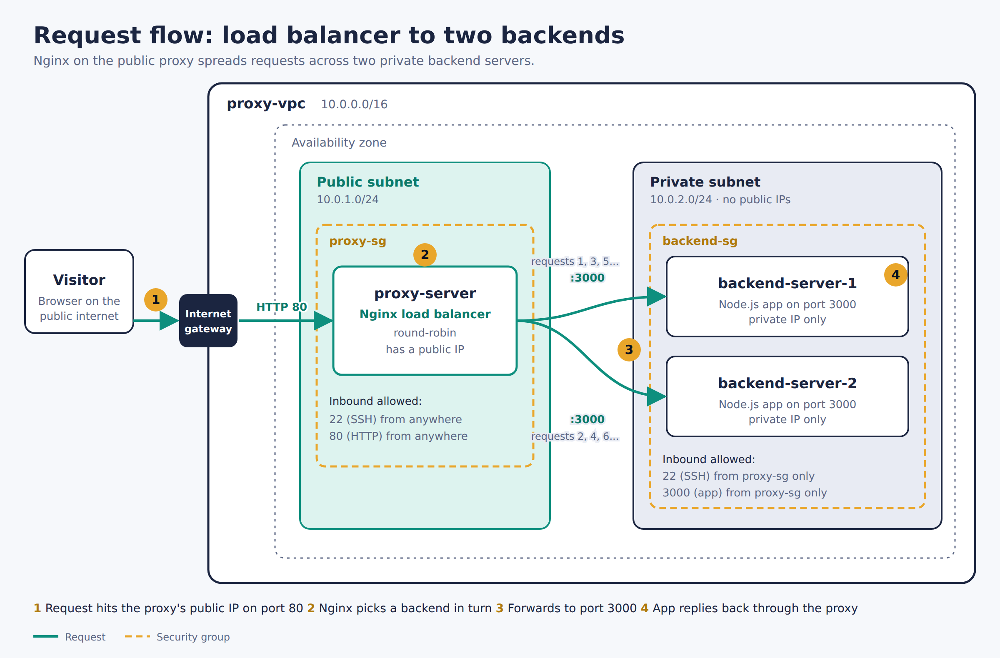

# Nginx load balancer demo

This project demonstrates a public Nginx load balancer distributing HTTP
requests across multiple private Node.js backend servers in an AWS VPC.
Terraform creates the network and EC2 instances; install and configure Nginx
and the app on those instances using the steps below.



## Architecture

- One Ubuntu EC2 instance in a public subnet runs Nginx and has a public IP.
- `backend_count` Ubuntu EC2 instances run the Node.js app in a private subnet
  and do not have public IPs.
- Nginx uses round-robin by default to distribute requests across the backend
  servers.
- The backend security group allows SSH and the app port only from the proxy
  security group.
- The optional NAT gateway provides outbound internet access to the private
  subnet so the backends can install Node.js. It is enabled by default and
  incurs ongoing AWS charges.

Terraform does not install or configure the software on the EC2 instances.
Complete the manual setup after applying the infrastructure.

## Prerequisites

- An AWS account and AWS CLI credentials with permission to create the
  Terraform resources.
- Terraform 1.3 or newer.
- Node.js on your local machine (Node.js 16 or newer) if you want to run the
  demo app locally.
- An existing EC2 key pair in the AWS region selected for this deployment.
  Keep its private key file on your local machine and do not commit it.

## 1. Configure and create the AWS infrastructure

Create `tf/terraform.tfvars` (this local file is ignored by Git) and set your
region, existing EC2 key pair, and public IP address for SSH access:

```hcl
region           = "us-east-1"
key_name         = "prodkey"
ssh_allowed_cidr = "YOUR_PUBLIC_IP/32"

# These are the defaults; adjust if needed.
backend_count     = 2
enable_nat_gateway = true
```

Use the name of your own existing key pair for `key_name`. Replace
`YOUR_PUBLIC_IP/32` with your public IP in CIDR notation. The Terraform default
allows SSH from anywhere, so set `ssh_allowed_cidr` explicitly to restrict
access.

Initialize, validate, review, and apply:

```bash
cd tf
terraform init
terraform validate
terraform plan
terraform apply
```

Review the plan before confirming `terraform apply`. The NAT gateway is enabled
by default to allow package downloads from the private subnet; it incurs
ongoing charges while it exists.

Terraform outputs the public IP of the proxy and the private IPs of all
backends. Display them again at any time with:

```bash
terraform output
```

Keep those IPs handy for the following steps. Commands below use
`PROXY_PUBLIC_IP` and `BACKEND_PRIVATE_IP` as placeholders; replace them with
the actual values from Terraform.

## 2. Start the app on each backend

From your local machine, copy `server.js` to each backend through the proxy.
Repeat the command once for each backend private IP:

```bash
scp -i /path/to/your-key.pem \
  -o ProxyJump=ubuntu@PROXY_PUBLIC_IP \
  server.js ubuntu@BACKEND_PRIVATE_IP:~/server.js
```

Connect to each backend through the proxy:

```bash
ssh -i /path/to/your-key.pem \
  -J ubuntu@PROXY_PUBLIC_IP \
  ubuntu@BACKEND_PRIVATE_IP
```

On each backend, install Node.js and start the app on port 3000:

```bash
sudo apt update
sudo apt install -y nodejs
PORT=3000 node ~/server.js
```

Leave the app running in each SSH session during the demo. The app's default
port is 3001; set `PORT=3000` here to match the Terraform security group and
the Nginx configuration below.

## 3. Configure Nginx on the proxy

Connect to the proxy:

```bash
ssh -i /path/to/your-key.pem ubuntu@PROXY_PUBLIC_IP
```

Install Nginx:

```bash
sudo apt update
sudo apt install -y nginx
```

Create an Nginx site configuration, replacing the example backend addresses
with the private IPs from Terraform. Include one `server` line for each
backend:

```nginx
upstream backend_pool {
    server BACKEND_1_PRIVATE_IP:3000;
    server BACKEND_2_PRIVATE_IP:3000;
}

server {
    listen 80;
    server_name _;

    location / {
        proxy_pass http://backend_pool;
        proxy_set_header Host              $host;
        proxy_set_header X-Real-IP         $remote_addr;
        proxy_set_header X-Forwarded-For   $proxy_add_x_forwarded_for;
        proxy_set_header X-Forwarded-Proto $scheme;
    }
}
```

Save the configuration above as `/etc/nginx/sites-available/load-balancer`,
replacing the backend placeholders first. For example, edit the file with:

```bash
sudo nano /etc/nginx/sites-available/load-balancer
```

Enable the site, disable the default welcome page, then test and reload Nginx:

```bash
sudo ln -s /etc/nginx/sites-available/load-balancer /etc/nginx/sites-enabled/load-balancer
sudo rm /etc/nginx/sites-enabled/default
sudo nginx -t
sudo systemctl reload nginx
```

## 4. Demonstrate load balancing

1. Open `http://PROXY_PUBLIC_IP` in your browser. The DevOpsHub demo page
   should load through Nginx.
2. Select **Trace this request** repeatedly. The backend hostname and private
   IP show which server answered; with both backends running, the responses
   should alternate between them.
3. The trace also shows that the backend connection comes from the proxy and
   that the browser's address is passed in the `X-Forwarded-For` header.
4. To observe a backend failure, stop the app on one backend and refresh or
   trace requests. Nginx will continue sending requests to the remaining
   backend after its passive failure handling detects the unavailable server.
   Restart the stopped app when finished.

The app is also available at `/api/courses` and `/api/whoami`. The
`/api/whoami` response includes the hostname of the backend that handled that
request.

## Cleanup

When you are finished, destroy the Terraform-managed resources to avoid
ongoing AWS charges, including the NAT gateway:

```bash
cd tf
terraform destroy
```
